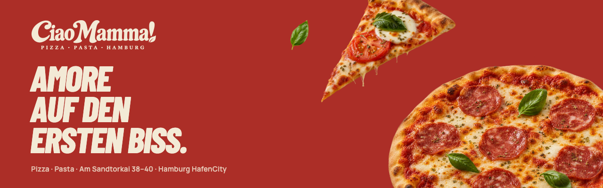
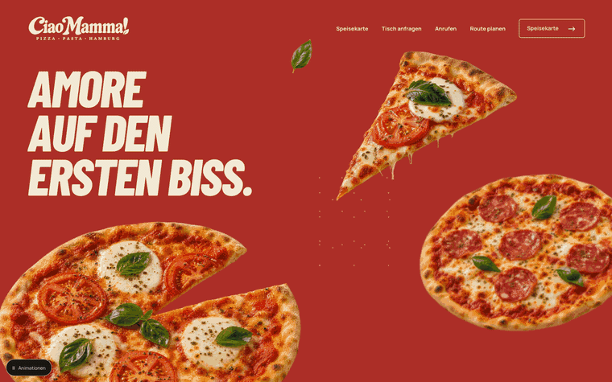
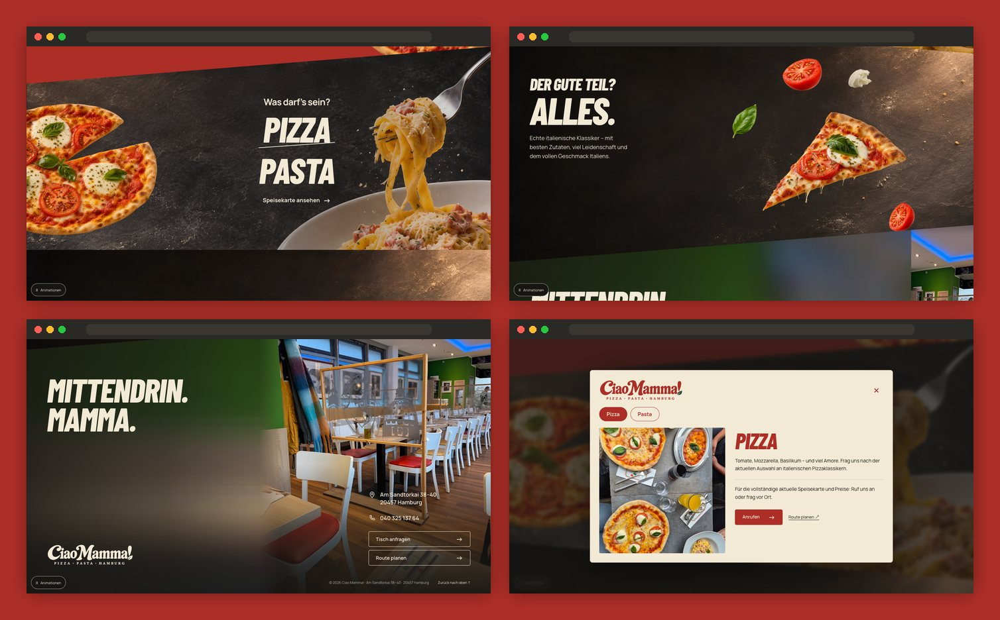
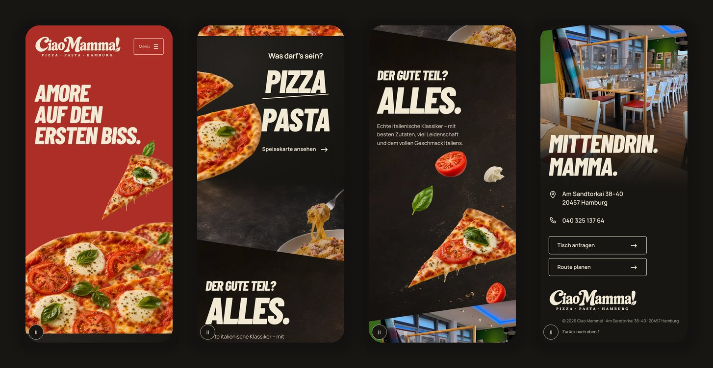

<div align="center">



<h3>A one-page website for an Italian restaurant in Hamburg's HafenCity, where one pizza leaves a red poster and lands on the table.</h3>

<p>
  <a href="#deployment"><strong>🌐 Live site (preview soon)</strong></a>
  &nbsp;·&nbsp;
  <a href="#hero-animation"><strong>🎬 How the hero works</strong></a>
  &nbsp;·&nbsp;
  <a href="#getting-started"><strong>🛠️ Run it locally</strong></a>
</p>

<p>
  <a href="#deployment"></a>
  
  
  
  
</p>

</div>

<br />

## 🚀 Overview

**Ciao Mamma!** serves pizza and pasta at Am Sandtorkai 38–40, in the middle of Hamburg's HafenCity. The site reads like an Italian poster brought to life: a red sheet with the line **"Amore auf den ersten Biss."**, a pizza that slides across a diagonal cut onto a stone table, the ingredients pulled out of a slice, and finally the real dining room with the address and the phone number.

Four scenes, three alternating diagonal cuts, one pizza carrying the eye from the first screen to the table. The copy is in German.

- **One continuous story**: the same pizza travels from the hero into the menu scene, so the page feels like one camera move instead of stacked blocks
- **Sized to the window, not zoomed**: every scene is composed from the window height, so pizzas, titles and photos keep a calm scale on laptops and big screens alike
- **Real place, real numbers**: the closing scene uses a photo of the actual dining room, shown whole; every call button dials 040 325 137 64 and every route link opens the right address
- **Light and dependency-free**: static HTML, CSS and JavaScript with self-hosted fonts, no framework, no CDN, 2.8 MB for the whole page in 21 requests

<br />

<a name="hero-animation"></a>

## 🎬 The hero animation

<div align="center">
  <a href="#deployment"></a>
  <sub>Scroll-driven, top to bottom · captured at 1440 × 900</sub>
</div>

<br />

The poster stays pinned for half a screen, then the story follows the scroll:

| Scroll                 | What happens                                                                                                   |
| :--------------------- | :------------------------------------------------------------------------------------------------------------- |
| On load (once)         | The pizza rises 100 px and turns from −8° in 1.5 s, the slice drops in, the three title lines rise 100 ms apart |
| First half screen      | Poster pinned: slice, second pizza, basil and crumbs drift at different speeds; ±4 px pointer parallax           |
| Into **Was darf's sein?** | The stone table climbs over the poster on a diagonal while one pizza flies from the poster to its place on the table, tilting up to 5° mid-flight |
| **Pizza / Pasta**      | The two words slide in from opposite sides, the slanted rule draws itself, the stone moves slower than the page  |
| **Der gute Teil? Alles.** | Tomato, mozzarella and basil leave the slice and settle around it, then float; **ALLES.** is stamped letter by letter |
| **Mittendrin. Mamma.** | The real dining room is uncovered from the right and settles from 1.02 to 1; title lines rise out of a mask, contact details follow |

**Under the hood**

- 🍕 **One pizza, two places.** The poster and the table each hold a measurable copy of the same image. While the transfer runs, a single fixed copy is interpolated between the two rectangles every frame, then hands back to the table's own copy in exactly the same spot (checked to within 4 px by the QA).
- 📐 **Composed from the window height.** One unit, `--u`, is 1 % of the window height (capped by width). At 1440 × 790 the hero is exactly one screen, the menu and ingredient scenes 0.80 and 0.82 screens and the closing scene 0.96. No photo is shown larger than its own pixels (checked at five window sizes).
- 🧭 **Event-driven, never looping.** `requestAnimationFrame` runs only after scroll, resize or pointer events; the opening plays once and leaves no running animation.
- 🐢 **Graceful by default.** Below 900 px there is no flying pizza, only local compositions. `prefers-reduced-motion`, Save-Data or the **Animationen** pause button (remembered in `localStorage`) give a static page with no empty pinned space; without JavaScript every text, call and map link is still there.

<br />

## 🖥️ Sections

<div align="center">
  
</div>

<br />

| #   | Section                           | Anchor         | Role                                                                                          |
| :-- | :-------------------------------- | :------------- | :-------------------------------------------------------------------------------------------- |
| 01  | **Amore auf den ersten Biss.**    | `#amore`       | Red poster, the only solid background; first impression and navigation                       |
| 02  | **Was darf's sein? Pizza / Pasta** | `#speisekarte` | The pizza lands on the stone table; both words open the menu dialog                          |
| 03  | **Der gute Teil? Alles.**         | `#zutaten`     | The ingredients pulled out of a slice, with the house line on quality                        |
| 04  | **Mittendrin. Mamma.**            | `#restaurant`  | The real dining room, address, phone, **Tisch anfragen** and **Route planen**; footer inside |
| ✦   | Pizza / Pasta dialog              | n/a            | Native `<dialog>` with keyboard tabs and a real photo from the restaurant's table            |

<br />

## 📱 Mobile first, motion optional

<div align="center">
  
</div>

<br />

- Each scene has its own phone composition: the pasta photo sits at the base of the menu scene, the dining room becomes a full-width band above the contact details
- Every touch target is at least 44 px; no horizontal scroll from 320 px up (checked at 320, 360, 390, 430, 768 and 820 px)
- Native menu (`<details>`) that closes when a section is chosen; nothing depends on hover

<br />

## ✨ Highlights

- **🎞️ Scroll storytelling**: a different technique per scene (pinned depth planes, a shared-element flight, masked word slides, an exploded view, a wipe reveal), tied together by one pizza
- **📞 Honest actions**: *Tisch anfragen* calls the restaurant and never pretends to confirm a booking; *Route planen* opens Google Maps on the exact address
- **🧾 Menu without invented prices**: the dialog presents Pizza and Pasta and points to the phone for the current menu until the restaurant supplies an authorised one
- **🖼️ Image pipeline**: the two real photos lose the photo viewer's strip and are upscaled with Real-ESRGAN ×4 (blended 60/40 with Lanczos so surfaces stay natural); the closing scene's soft side panel is grown out of the photo's own edge, so it continues without a seam
- **♿ Accessible components**: one `h1`, skip link, keyboard tabs (arrows, Home, End) in the dialog, focus returned on close, visible focus rings, decorative images hidden from assistive tech
- **🧪 Two test suites**: `npm run qa` (111 browser checks: density at real window sizes, title never under a pizza, interactions, fallbacks) and the kit checker (105 static checks: scene order, contacts, assets, fonts, hashes)

<br />

## 💻 Tech stack

| <br />HTML5 | <br />CSS3 | <br />JavaScript | <br />Python | <br />Real-ESRGAN | <br />Playwright | <br />Vercel |
| :---: | :---: | :---: | :---: | :---: | :---: | :---: |

### Why this stack?

- **Plain HTML, CSS and JavaScript**: four scenes and one dialog don't need a framework or a build step; `site/` opens as it is
- **CSS custom properties driven by one small script**: scroll positions become a handful of variables (`--e`, `--venue-reveal`, …) and CSS does the drawing
- **Python image pipeline**: Pillow for crops and WebP, Real-ESRGAN (through spandrel and PyTorch) for the low-resolution real photos and the stone backgrounds
- **Playwright**: the density gates and interaction checks run in a real browser at real window sizes
- **Vercel**: static hosting straight from `site/`, every push to `main` deploys once the project is connected

<br />

## 🎨 Design system

| Token    | Value                                                                       | Use                                         |
| :------- | :-------------------------------------------------------------------------- | :------------------------------------------ |
| Pomodoro |  | The poster, buttons in the dialog, logo     |
| Creme    |  | Type and logo on red and dark photography   |
| Basilico |  | Brand green (logo leaf, brand files)        |
| Carbone  |  | Page background, shades, controls           |

- **Type**: Barlow Condensed ExtraBold Italic for display (15 % of the window height for the poster, about 118 px at 1440 × 790), Manrope 400–700 for text and interface
- **Scale**: one unit `--u` = 1 % of the window height, capped at 0.56 % of its width; small text is clamped in pixels, never scaled with the images
- **Cuts**: three diagonals, up / down / up, sharing one `--seam` height (58 px on phones)
- **Motion**: text reveals of 18 px over 800 ms, once; scroll scale never above 1.02; no endless loops

<br />

<a name="getting-started"></a>

## 🛠️ Getting started

```bash
# Clone the repository
git clone https://github.com/Jeanfr1/Ciao-Mamma-website.git
cd Ciao-Mamma-website

# Install the QA dependency (playwright-core; the site itself has none)
npm install

# Serve site/  →  http://localhost:4431
npm run dev

# Browser QA (111 checks), with the dev server running
npm run qa

# Static kit checks (Python with Pillow and fontTools)
npm run kit

# Rebuild the production images (Python with torch + spandrel, RealESRGAN_x4plus.pth in ~/.cache/realesrgan)
python3 scripts/prepare-images.py

# Refresh docs/asset-manifest.json and MANIFEST.sha256 after changing assets
python3 scripts/sync-manifests.py
```

No build step: `site/` is the production folder.

<br />

## 📁 Project structure

```
Ciao-Mamma-website/
├── site/                       # The website, deployed as is
│   ├── index.html              # Four scenes: amore → speisekarte → zutaten → restaurant (+ footer), dialog
│   ├── styles.css              # Tokens, height-based scene units, diagonals, phone / tablet / desktop layouts
│   ├── app.js                  # Opening, shared pizza flight, scroll variables, reveals, pause, dialog
│   ├── content.js              # Contact data and the Pizza / Pasta texts; TODO(ciao) list
│   ├── assets/                 # WebP images, SVG logos and favicon
│   └── fonts/                  # Barlow Condensed and Manrope (WOFF + OFL)
├── scripts/
│   ├── prepare-images.py       # Crops, Real-ESRGAN upscales, ambient panel, ingredient sizes
│   ├── qa.mjs                  # Browser QA (density, layout, interactions, fallbacks)
│   ├── measure.mjs             # Scene and image sizes at real window sizes
│   ├── filmstrip.mjs           # Scroll film for motion review
│   ├── readme-assets.mjs       # README captures
│   ├── readme-compose.py       # Banner, GIF and framed screenshots
│   └── sync-manifests.py       # Asset manifest + SHA-256 manifest
├── roteiros/                   # Art direction, motion, scenes, content, images, validation (PT)
├── references/                 # Approved model 2 working board
├── images/master/              # Eight campaign masters (six transparent cut-outs, two stone stages)
├── brand/                      # Logos (SVG + transparent PNG), sign, avatar, palette, tokens
├── docs/ · motion/ · tools/    # Decisions, sources, QA report, timeline, kit checker and exporter
├── LEIA-ME-KIT.md              # The design kit's own read-me (PT)
└── vercel.json                 # Publishes site/ with no build, noindex while in preview
```

<br />

<a name="deployment"></a>

## 🚀 Deployment

Built for **Vercel** as a static site. The preview has not been published yet; once the project is connected, every push to `main` ships to production.

| Setting          | Value                  |
| :--------------- | :--------------------- |
| Framework        | Other (static)         |
| Build command    | none                   |
| Output directory | `site`                 |
| Indexing         | `noindex` (meta tag, `X-Robots-Tag` header, `robots.txt`) until the restaurant's own domain is set |

`.vercelignore` keeps the kit folders (brand sources, masters, references, scripts) out of the deployment.

<br />

## 📌 Content checklist

Items waiting on the restaurant. Each one is marked `TODO(ciao)` in `site/content.js` (and `site/index.html` for the domain).

- [ ] Current full menu and prices, authorised by the restaurant (text, PDF or URL), to replace the Pizza / Pasta overview
- [ ] Impressum and Datenschutz texts approved by the owner, before the site moves to the restaurant's domain
- [ ] Permission for the two real photos (dining room and table) or the owner's own photos
- [ ] Opening hours, only if the owner confirms them (not published until then)
- [ ] Own domain: then add `canonical` and `og:url` and remove `noindex` (meta tag, `vercel.json`, `robots.txt`)

Choices made while building from the kit:

- The kit's own page scaled its scenes with the window width (1.2 to 1.5 screens each at 1440 × 790, pizzas covering the title, the dining-room photo enlarged 1.9×). The scenes were recomposed from the window height so each one fits on screen and every image stays at or below its own resolution.
- The two real photos are exported pre-cropped (no photo-viewer strip, no black border) instead of being cropped by an SVG `viewBox`.
- The kit's concept references and the two uncropped visitor photos stay out of the public repository.

<br />

## 🙏 Acknowledgments

- **Ciao Mamma!**, Am Sandtorkai 38–40, Hamburg, the restaurant this design was made for
- **[Barlow Condensed](https://fonts.google.com/specimen/Barlow+Condensed)** by Jeremy Tribby and **[Manrope](https://fonts.google.com/specimen/Manrope)** by Mikhail Sharanda (OFL)
- **[Real-ESRGAN](https://github.com/xinntao/Real-ESRGAN)** by Xintao Wang et al. (BSD-3-Clause) and **[spandrel](https://github.com/chaiNNer-org/spandrel)**
- **[Playwright](https://playwright.dev)** and **[Vercel](https://vercel.com)**

<br />

---

<div align="center">
  
  <p><strong>Amore auf den ersten Biss.</strong></p>
  <p>Built with ❤️ by <a href="https://github.com/Jeanfr1">Jean</a> for Ciao Mamma!</p>
  <sub>© 2026 Ciao Mamma! All rights reserved.</sub>
</div>
